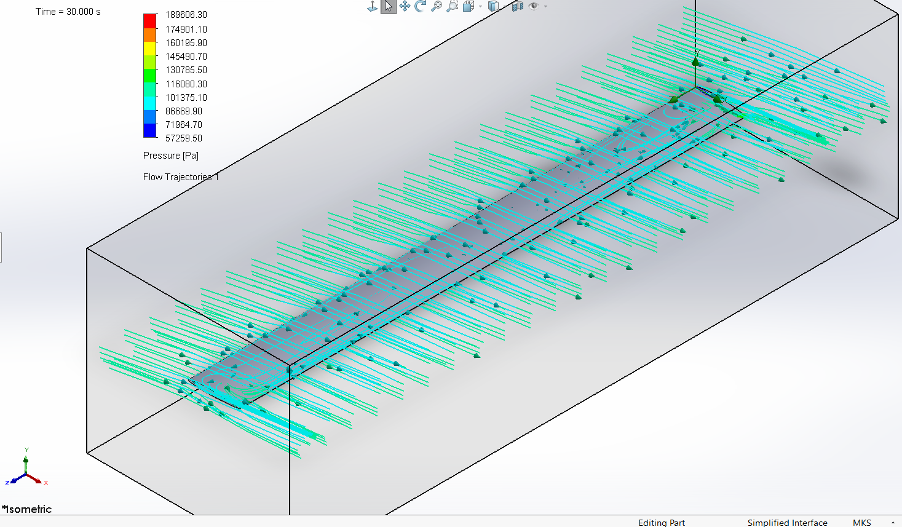
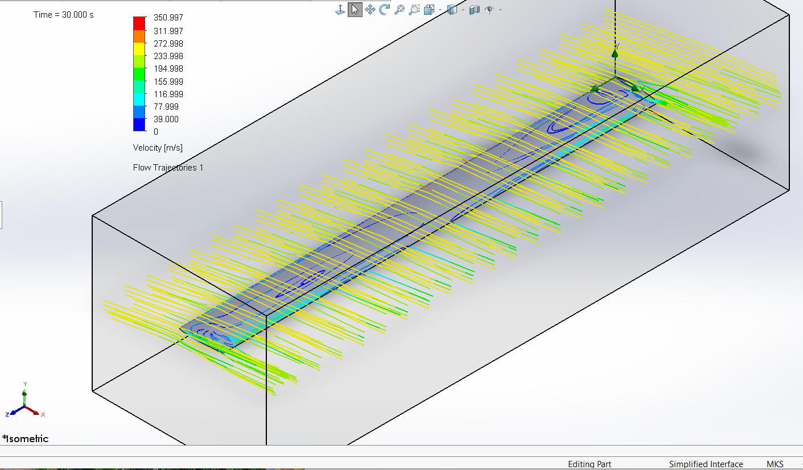
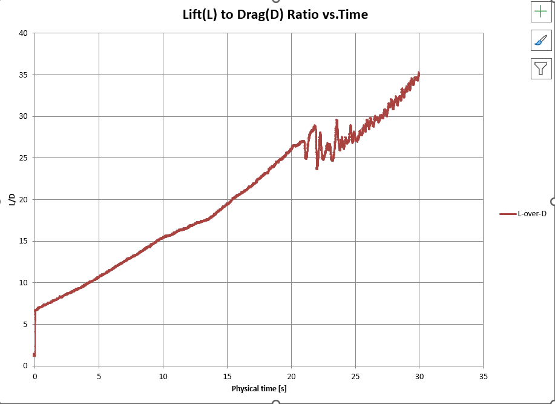

# naca-airfoil-cfd
3D NACA airfoil modeling and transient CFD aerodynamic simulation in SolidWorks
# NACA Airfoil Aerodynamic & CFD Analysis

## Overview
Modeled a 3D aircraft wing section based on coordinates from the NACA airfoil database and conducted a 30-second transient Computational Fluid Dynamics (CFD) simulation in **SolidWorks Flow Simulation**. The simulation evaluated aerodynamic performance across a sweeping angle of attack (AoA) from **-2° to 10°**.

## 📄 Technical Report
* **[View Full Project Report (PDF)](NACA-Airfoil-Report.pdf)** — Includes problem setup, boundary conditions, simulation methodology, and full aerodynamic data analysis.

## Key Results
* **Peak Lift Force:** Achieved a maximum lift of **918 kN** during the AoA sweep.
* **Aerodynamic Performance Curves:** Generated and analyzed time-dependent plots for:
  * Lift Force ($L$) & Drag Force ($D$)
  * Lift-to-Drag Ratio ($L/D$)
  * Lift Coefficient ($C_L$) & Drag Coefficient ($C_D$)
* **Flow Visualization:** Captured velocity and pressure flow trajectories around the airfoil profile to observe boundary layer behavior and flow separation at higher angles of attack.

## Visuals & Simulation Plots
### Flow Trajectory

### Aerodynamic Performance Graphs

## Tools & Methods
* **CAD Modeling:** SolidWorks (NACA coordinate curve import & lofted/extruded wing geometry)
* **Simulation:** SolidWorks Flow Simulation (Transient external airflow analysis, sweeping AoA boundary conditions)
